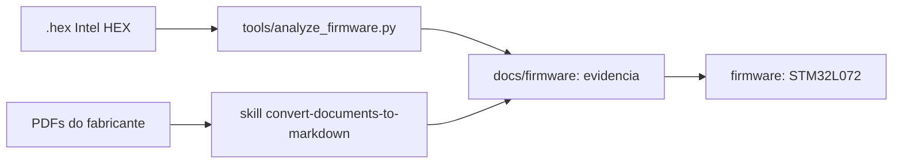

# Acervo de engenharia reversa — Dragino LSN50 (STM32L072)

[](firmware/)
[](firmware/)
[](LICENSE.md)
[](tools/)

Estudo de caso completo de engenharia reversa de um nó LoRaWAN de campo: a
partir **apenas** da imagem de firmware distribuída
(`FIRMWARE/LSN50_AU915_v1.8.1.hex`) e dos documentos do fabricante, o
comportamento do produto foi levantado com evidência rastreável e
reimplementado como firmware próprio para o **mesmo** microcontrolador.

## O que tem aqui

| Caminho | Conteúdo |
|---|---|
| `FIRMWARE/` | Imagem Intel HEX original do LSN50 AU915 v1.8.1 (fonte da verdade do estudo) |
| `Node-Dragino - LSN50v2/` | PDFs do fabricante (comandos AT, manual do usuário, esquemático **CC BY-SA 3.0**) **+ o Markdown convertido ao lado de cada um** |
| `datasheets/` | Datasheet do STM32L072CZT6 |
| `docs/firmware/` | Evidência estática extraída do binário e relatório de análise |
| `firmware/` | Firmware próprio para o STM32L072CZT6, com o mesmo contrato de comandos AT |
| `tools/` | Analisador de imagem ARM e decodificador de payload |
| `.agents/skills/`, `.github/skills/` | Instruções que orquestram o trabalho dos agentes neste repositório |



## A skill REA (`reverse-engineer-anything`)

O trabalho seguiu a skill **REA**, cujas instruções estão em
`~/.agents/skills/reverse-engineer-anything/SKILL.md` (v37, 170 ferramentas).
Ela define como investigar artefatos **já entregues** — binários nativos, código
gerenciado, aplicações Electron/JavaScript, pacotes e imagens de firmware — e
roteia cada tipo de alvo para a ferramenta adequada:

- binários/arquivos compactados → `open_binary` e inventário do artefato;
- **imagens de firmware** → `inspect_firmware_regions` (Binwalk) e
  `extract_firmware` (Unblob), com orçamento de bytes e diretório de saída
  escolhido pelo chamador;
- ELF Linux, APK, ASAR/JavaScript, PE gerenciado, páginas de navegador e
  aplicações Electron → ferramentas dedicadas de cada família.

Mais do que a lista de ferramentas, a skill impõe **princípios de método** que
foram seguidos neste estudo:

1. trabalhar *summary-first* e só aprofundar onde há pergunta em aberto;
2. manter um **ledger de evidências** ligando cada conclusão à sua fonte;
3. separar rigorosamente **observado**, **inferência** e **desconhecido**;
4. registrar a identidade do artefato (aqui, SHA-256 do `.hex` e dos PDFs);
5. nunca sugerir que análise estática observou execução real.

**Adaptação necessária.** Um Intel HEX de STM32 não é um alvo suportado pelo
conjunto de ferramentas do REA: não é um contêiner (ASAR/APK/IPA/MSIX), nem ELF,
Mach-O ou PE, e o Binwalk/Unblob não extraem uma imagem plana de 87 KiB. Em vez
de forçar uma ferramenta fora de escopo, o repositório ganhou
`tools/analyze_firmware.py`, escrito para o formato específico, aplicando os
mesmos princípios: cada saída traz o endereço de origem, cada conclusão está no
ledger e o que não pôde ser determinado está declarado como lacuna.

## Estudo de caso: LSN50 AU915 v1.8.1

### Artefatos e integridade

| Artefato | SHA-256 (prefixo) |
|---|---|
| `FIRMWARE/LSN50_AU915_v1.8.1.hex` | `25a15824fb5d64b9…` |
| `DRAGINO_LSN50_AT_Commands_v1.6.3.pdf` | `c0b7e3e3e47971fb…` |
| `LSN50_LoRa_Sensor_Node_UserManual_v1.7.4.pdf` | `e724e7c033aad2be…` |
| `LoRa ST Sensor Node v2.0.sch.pdf` | `9e6d06844d98b373…` |
| `datasheets/STM32L072CZT6-C1337587.pdf` | `13ea53054244ac9d…` |

Hashes completos e a reprodução de cada extração estão em
[`docs/firmware/LSN50_AU915_v1.8.1-analise.md`](docs/firmware/LSN50_AU915_v1.8.1-analise.md).

### Método

```bash
# HEX=FIRMWARE/LSN50_AU915_v1.8.1.hex
python3 tools/analyze_firmware.py "$HEX"              # mapa + tabela de vetores
python3 tools/analyze_firmware.py "$HEX" --at-table    # descritores dos AT
python3 tools/analyze_firmware.py "$HEX" --strings     # strings e endereços
python3 tools/analyze_firmware.py "$HEX" --consts      # periféricos e EEPROM
python3 tools/analyze_firmware.py "$HEX" --disasm 0x08013e34,0x90
```

O analisador converte o Intel HEX em mapa de memória, monta a tabela de vetores
com nomes de IRQ do STM32L072, procura ponteiros para strings, identifica
constantes de endereço e desmonta em Thumb (Cortex-M0+, ARMv6-M) com o Capstone.
Os PDFs foram convertidos com a skill `convert-documents-to-markdown` (anydoc);
o esquemático e o fluxograma do manual, por serem gráficos, foram renderizados
com `pdftoppm` e inspecionados como imagem.

### Principais achados

| Achado | Evidência |
|---|---|
| Imagem de 88 976 B em `0x08000000–0x08015B90` (86,9 KiB, 45 % da flash), pilha inicial em `0x20001DC0` | mapa de memória |
| **Tabela de 61 comandos AT** em `0x08013E34`, descritores de 24 bytes (`nome`, `id`, `get`, `set`, `help`) | reconstrução + desmontagem |
| Handlers são wrappers de ~20 bytes sobre rotinas genéricas; `0x08011760` é `movs r0,#1; bx lr` (stub) | desmontagem |
| Parâmetros persistidos na **EEPROM de dados** do próprio MCU (`0x08080000`, `+4`, `+58`, `+60`) | constantes de 32 bits no binário |
| Periféricos ativos: RTC, EXTI 0_1/2_3/4_15, DMA1_Ch4_7, TIM3, TIM21, USART1, I2C1, SPI1, ADC — e **USART2 apontando para o `Default_Handler`** | tabela de vetores |
| Identidade do produto: `LSN50 Device`, `Image Version: v1.8.1`, `LoRaWan Stack: DR-LWS-007`, `AU915` | strings em `0x0800828E`, `0x080082A0`, `0x080082B8`, `0x08013058` |
| Ciclo de operação: ligar 5 V → amostrar → desligar 5 V → uplink (LED) → RX1/RX2 → STOP, acordando por RTC/EXTI | fluxograma do manual §2.1 (p. 12) + handlers de RTC/EXTI |
| Payloads MOD1..MOD6 com escalas documentadas (bateria em mV, temperatura em décimos com sinal, ADC em mV) | manual §2.3 e §2.4 |

**Lacunas declaradas** (não foram resolvidas com o material disponível): os
pinos SPI1/NSS/RESET/DIO0 do rádio, que fica **dentro** do módulo M.2 e não
aparece no esquemático da placa portadora; o console serial (o manual diz
USART2, o binário tem handler real só na USART1); e o valor do vetor de
`LPUART1_RNG`, que aponta para código de conversão numérica.

O relatório completo, com as observações separadas de inferências e as
inferências separadas dos desconhecidos, está em
[`docs/firmware/`](docs/firmware/).

## Reimplementação: `firmware/`

Firmware próprio para o **mesmo** STM32L072CZT6, reproduzindo a arquitetura
levantada — com o núcleo de lógica isolado em código portátil, de modo que
grande parte dele seja verificável sem hardware:

- `core/` — motor de comandos AT (descritores + parser + respostas
  `OK`/`AT_ERROR`/…), configuração com CRC-16, payloads MOD1..MOD6 e
  AES-128/AES-CMAC (exigidos pelo LoRaWAN). **Sem header de MCU**;
- `src/` — alvo em CMSIS puro (sem HAL): clock, GPIO, USART, SPI, I2C, ADC,
  1-Wire, EEPROM, RTC/STOP, EXTI, driver SX1276, LoRaWAN Class A (OTAA/ABP,
  uplink e janelas RX1/RX2) e console com `printf` próprio;
- 60 comandos AT com os **mesmos nomes, ids e textos de ajuda** do binário original.

```bash
cd firmware
pio run -e l072              # firmware do alvo (Cortex-M0+)
pio run -e native -t exec    # testes de host do núcleo portátil
```

| Verificação | Resultado |
|---|---|
| Build do alvo | 0 erros, 0 avisos — 40 592 B de flash (20,6 %) e 1 688 B de RAM (8,2 %) |
| Testes de host | **89 verificações, 0 falhas** — AES-128 (FIPS-197), AES-CMAC (RFC 4493), codec de configuração, MOD1..MOD6 com os valores do manual, parser AT |
| Decodificador (`tools/decode_payload.py --selftest`) | 12 verificações, 0 falhas |

O mapa "comando → evidência" e as pendências que exigem bancada estão em
[`firmware/README.md`](firmware/README.md).

## Ferramentas do repositório

- **`tools/analyze_firmware.py`** — Intel HEX → mapa de memória, vetores nomeados,
  strings, tabela de descritores AT, constantes de endereço e desmontagem Thumb.
- **`tools/decode_payload.py`** — decodificador MOD1..MOD6 (espelho do firmware,
  com autoverificação) para uso em servidor LoRaWAN.
- **`.agents/skills/convert-documents-to-markdown`** — conversão de PDF/DOCX/XLSX
  para Markdown, usada em todo o acervo.
- **`.github/skills/create-readme`** — convenções deste repositório para READMEs.

---

> [!IMPORTANT]
> **Origem, licença — e o que o agente não viu.** O LSN50 é um produto de
> hardware e firmware abertos, e o acervo parte dos artefatos que a Dragino
> publica:
>
> - **hardware** — [`dragino/Lora` → `LSN50/`](https://github.com/dragino/Lora/tree/master/LSN50),
>   com as revisões de projeto de v1.0 a v3.3.1. O esquemático deste acervo
>   (`LoRa ST Sensor Node v2.0.sch.pdf`) declara a licença no próprio bloco de
>   título: *“Released under the CC Attribution Share-Alike 3.0 License”*, com
>   a URL `creativecommons.org/licenses/by-sa/3.0/` — isto é, **CC BY-SA 3.0**.
>   A evidência está recortada em
>   [`docs/firmware/LSN50v2_bloco_titulo_CC-BY-SA-3.0.png`](docs/firmware/LSN50v2_bloco_titulo_CC-BY-SA-3.0.png),
>   porque o desenho tem o texto vetorizado e a extração automática do PDF não
>   devolve esse trecho;
> - **firmware** — [`dragino/LoRa_STM32`](https://github.com/dragino/LoRa_STM32),
>   que publica o código do LSN50/LoRaST e a pasta `LSN50.hex/`, apontada pelo
>   próprio manual como origem da imagem distribuída — a mesma imagem que este
>   acervo adota como fonte da verdade. Na verificação de 2026-10-12 esse
>   repositório **não traz arquivo `LICENSE`** e sua pilha LoRaWAN deriva do
>   `STM32CubeExpansion_LRWAN` da ST, com licença própria; a licença do código
>   do fabricante precisa, portanto, ser confirmada na origem antes de qualquer
>   redistribuição dele.
>
> Dito isso, **o agente de IA não teve acesso ao código-fonte original**: o
> repositório do fabricante não foi consultado para explicar comportamento,
> nenhuma ferramenta o usou como referência e nenhuma linha dele foi copiada
> para `firmware/`. Todo o entendimento registrado neste acervo foi reconstruído
> a partir do binário e dos documentos aqui presentes — e é justamente isso que
> faz do trabalho um caso legítimo de engenharia reversa de artefato entregue,
> e não uma leitura de código. A única convergência com o repositório público é
> textual e serve de aferição de linhagem: a string `LSN50 Device`, recuperada
> do `.hex` em `0x0800828E`, coincide com o `PRINTF` da fonte publicada — o que
> confirma que o firmware analisado é o daquele produto, **sem** que sua lógica
> tenha sido lida.
>
> *Consequência prática da licença:* os PDFs do fabricante e as figuras
> derivadas deles neste repositório (o esquemático renderizado, o fluxograma do
> manual) continuam sob a licença da origem — **CC BY-SA 3.0** no caso do
> hardware — e exigem atribuição e *ShareAlike* em qualquer reuso. Já o código
> em `firmware/`, as ferramentas em `tools/` e os textos de análise em `docs/`
> são trabalho próprio deste acervo, licenciado sob **CC BY-SA 4.0**: o
> detalhamento da divisão, a forma de atribuição e as ressalvas estão em
> [`LICENSE.md`](LICENSE.md).
