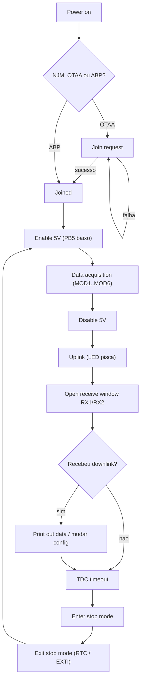

# LSN50 AU915 v1.8.1 — como o firmware funciona

> Relatório de engenharia reversa do arquivo `FIRMWARE/LSN50_AU915_v1.8.1.hex`,
> cruzado com os PDFs do acervo. Cada afirmação abaixo está marcada como
> **[observado]**, **[inferência]** ou **[desconhecido]**, com a evidência que a
> sustenta.

## 1. Artefatos analisados

| Artefato | SHA-256 |
|---|---|
| `FIRMWARE/LSN50_AU915_v1.8.1.hex` | `25a15824fb5d64b9ed984d41d674fc42396e44bbc8b09da1286ad644a6abd15b` |
| `Node-Dragino - LSN50v2/DRAGINO_LSN50_AT_Commands_v1.6.3.pdf` | `c0b7e3e3e47971fbbd0bce903c758cb1c8457dea1ce3f10043c631ff2a58b503` |
| `Node-Dragino - LSN50v2/LSN50_LoRa_Sensor_Node_UserManual_v1.7.4.pdf` | `e724e7c033aad2beb91c0eebefa2033593d98bc75f91ad3df5f82fc9995cd165` |
| `Node-Dragino - LSN50v2/LoRa ST Sensor Node v2.0.sch.pdf` | `9e6d06844d98b373ea1e9d0046a024f5a0b6eeae35567b77af208e2c87810574` |
| `datasheets/STM32L072CZT6-C1337587.pdf` | `13ea53054244ac9d225812ac8494f841e958547c75d295074e515a24ffd85788` |

Derivados versionados junto (convenção do `.gitignore` do repositório):

- `LSN50_AU915_v1.8.1-map.txt` — mapa de memória, tabela de vetores e
  desmontagem das rotinas citadas aqui;
- `LSN50_AU915_v1.8.1-at-table.txt` — tabela de comandos AT reconstruída;
- `LSN50_AU915_v1.8.1-strings.txt` — 1 428 strings ASCII com endereço;
- `LSN50_AU915_v1.8.1-consts.txt` — constantes de endereço (RAM/periféricos/EEPROM);
- `LSN50_fluxo_manual_2.1_p12.png` — fluxograma "How it works" do manual (p. 12);
- `LSN50v2_esquematico_v2.0.png` — esquemático renderizado (PDF vetorial);
- `LSN50v2_bloco_titulo_CC-BY-SA-3.0.png` — recorte do bloco de título do
  esquemático, onde está declarada a licença.

### Origem e licença **[observado]**

O projeto de referência é publicado pela Dragino em dois repositórios: o
**hardware** em [`dragino/Lora` → `LSN50/`](https://github.com/dragino/Lora/tree/master/LSN50)
(revisões de v1.0 a v3.3.1) e o **firmware** em
[`dragino/LoRa_STM32`](https://github.com/dragino/LoRa_STM32), cuja pasta
`LSN50.hex/` é apontada pelo próprio manual como origem da imagem distribuída —
a mesma que este acervo usa como fonte da verdade.

O bloco de título do esquemático da placa diz *"Released under the CC
Attribution Share-Alike 3.0 License"* com a URL
`creativecommons.org/licenses/by-sa/3.0/`, ou seja **CC BY-SA 3.0**
(recorte em `LSN50v2_bloco_titulo_CC-BY-SA-3.0.png`). O desenho tem o texto
vetorizado, o que explica a extração de texto vazia nesse PDF e a conversão
corrompida do `.sch.md` versionado ao lado dele.

O repositório **do fabricante** (firmware) não traz arquivo `LICENSE`
(verificado em 2026-10-12) e sua pilha LoRaWAN deriva do
`STM32CubeExpansion_LRWAN` da ST, com licença própria — a licença do código do
fabricante precisa ser confirmada na origem antes de redistribuí-lo. A licença
deste acervo (trabalho próprio × material de terceiros) está em
[`LICENSE.md`](../../LICENSE.md).

**O agente não teve acesso ao código-fonte original**: toda a análise deste
documento deriva do `.hex` e dos PDFs do acervo. A única coincidência com o
repositório público é textual — a string `LSN50 Device` do binário
(`0x0800828E`) é a mesma do `PRINTF` da fonte publicada —, o que serve para
aferir a linhagem do artefato, não para explicar seu comportamento.

Reprodução (ferramenta própria, `tools/analyze_firmware.py`):

```bash
python3 tools/analyze_firmware.py FIRMWARE/LSN50_AU915_v1.8.1.hex            # mapa + vetores
python3 tools/analyze_firmware.py FIRMWARE/LSN50_AU915_v1.8.1.hex --at-table # tabela AT
python3 tools/analyze_firmware.py FIRMWARE/LSN50_AU915_v1.8.1.hex --strings  # strings
python3 tools/analyze_firmware.py FIRMWARE/LSN50_AU915_v1.8.1.hex --consts   # endereços
python3 tools/analyze_firmware.py FIRMWARE/LSN50_AU915_v1.8.1.hex --disasm 0x08013e34,0x90
```

## 2. O alvo em uma página

| Item | Valor | Evidência |
|---|---|---|
| MCU | STM32L072CZT6 (Cortex-M0+, 192 KB flash, 20 KB RAM, 6 KB EEPROM de dados) | manual §1.2; datasheet; **VREFINT_CAL em 0x1FF80078** e **TS_CAL1/2 em 0x1FF8007A/0x1FF8007E** confirmados no datasheet (§6.3.3 / tabela 28) |
| Imagem | 88 976 B contíguos em `0x08000000–0x08015B90` (86,9 KiB, 45 % da flash) | **[observado]** mapa de memória |
| Stack inicial | `0x20001DC0` (não o topo da RAM, `0x20005000`) | **[observado]** vetor `Initial_SP` — ver §7 |
| Banda | AU915 (o nome do arquivo) + string `AU915` em `0x08013058` | **[observado]** |
| Versão | `Image Version: v1.8.1` (0x080082a0) e `v1.8.1` (0x08013498) | **[observado]** |
| Pilha de rede | `LoRaWan Stack: DR-LWS-007` (0x080082b8) | **[observado]** — é a pilha Dragino, não o LoRaMac-node |

## 3. Mapa de vetores: o que o firmware usa de verdade

Os 37 vetores não nulos (de 48) mostram os periféricos realmente usados
**[observado]**:

| Handler | Endereço | Leitura |
|---|---|---|
| Reset | `0x080000D4` | `blx SystemInit` (0x0800EC94) e `bx 0x080000C0` (runtime C) |
| NMI / HardFault / SVCall / PendSV / SysTick | `0x08009A54`, `0x08007ABC`, `0x0800C912`, `0x0800A96C`, `0x0800EC00` | rotinas do runtime/CMSIS |
| RTC (IRQ 2) | `0x0800B262` | acesso a registradores de backup → temporização de ciclo |
| EXTI0_1 / EXTI2_3 / EXTI4_15 | `0x08003828` / `0x08003838` / `0x08003848` | três ISRs que chamam um despachante comum `0x08004A08`; a de EXTI4_15 é a maior → entradas `INTMOD1/2/3` |
| DMA1_Ch4_7 (IRQ 11) | `0x08002A38` | possível uso de DMA (SPI/ADC) |
| TIM3 (IRQ 16), TIM21 (IRQ 20) | `0x0800ECF0`, `0x0800ECE8` | base de tempo; TIM21 é o candidato a medição de largura de pulso |
| USART1 (IRQ 27) | `0x0800F6EC` | **handler real** |
| USART2 (IRQ 28) | `0x080000E6` | **Default_Handler** (o handler comum é `b .` — `0x080000E6: b #0x80000e6`) |
| LPUART1_RNG (IRQ 29) | `0x0800B1FC` | atenção: o alvo desse vetor é código de conversão numérica → **[desconhecido]**, ver §7 |

## 4. Periféricos e armazenamento de parâmetros

Constantes de 32 bits encontradas no código (`--consts`) **[observado]**, todas
coerentes com a base dos periféricos do STM32L072:

| Endereço | Periférico | Uso provável |
|---|---|---|
| `0x40000400` | TIM3 | base de tempo |
| `0x40002800` | RTC | ciclo de acordar/dormir |
| `0x40003000` | IWDG | watchdog |
| `0x40004400` | USART2 | console (PA2/PA3, 9600 8N1 — manual §1.1) |
| `0x40005400` | I2C1 | SHT2x/SHT3x/BH1750, LiDAR |
| `0x40007000` | PWR | STOP mode |
| `0x40010400` | EXTI | entradas de interrupção |
| `0x40010800` | TIM21 | medição de pulso |
| `0x40012400` | ADC | PA0/PA1/PA4 + referência interna |
| `0x40013000` | SPI1 | SX1276 |
| `0x40013800` | USART1 | **console ou TF-Luna (UART)** — ver §7 |
| `0x50000400`…`0x50001C00` | GPIOB..GPIOH | 5 portas GPIO |
| `0x40021000` / `0x40022000` | RCC / FLASH | clock e programação |
| `0x08080000`, `0x08080004`, `0x08080058`, `0x08080060` | **EEPROM de dados** | persistência da configuração |

Isto é a base factual da decisão de projeto: **os parâmetros dos AT commands
são gravados na EEPROM interna do próprio MCU**, não em memória externa.

## 5. O coração do firmware: 61 comandos AT em tabela

O bloco `0x08013E34–0x080143D4` contém **61 descritores de 24 bytes**, cada um:

```
+0x00  char*  nome curto      "+VER" (o ATZ usa "Z")
+0x04  uint32 id/flags
+0x08  uint32 handler A       (leitura:  "AT+XXX=?")
+0x0c  uint32 handler B       (escrita/execução: "AT+XXX=valor" ou "AT+XXX")
+0x10  uint32 handler C       (ajuda: "AT+XXX?")
+0x14  char*  texto de ajuda  "AT+VER: Get current image version and Frequency Band"
```

Provas da estrutura: em `0x08013E4C` o campo nome aponta para a string `"Z"` em
`0x08015AE0`, o id é 1 e a ajuda em `0x08014FA0` é `"ATZ: Trig a reset of the
MCU"`; em `0x08013E64` o nome é `"+FDR"`, o id 4 e a ajuda `0x0801517C`
(`"AT+FDR: Reset Parameters to Factory Default, Keys Reserve"`).

Os handlers não são funções dedicadas grandes, mas **wrappers curtos de ~20
bytes** sobre rotinas genéricas. Exemplos desmontados:

- `+MOD=?` → `0x08010C2C`: `push {r4,lr}; ldr r0,=<ponteiro>; ldrb r0,[r0];
  bl 0x08012DAC; movs r0,#0` — lê 1 byte da configuração e imprime.
- `+MOD=valor` → `0x08010C40`: `mov r2,sp; adr r1,#0x30; bl 0x0801354C;
  cmp r0,#1; bne erro; ldrb r0,[sp]; subs r1,r0,#1; cmp r1,#8` — converte o
  argumento, valida a faixa e grava.
- `+SENDB=port:hex` → `0x080111FC`: laço que reconhece dígitos (`subs r0,#0x30;
  cmp r0,#9`) e o separador `':'` (`cmp r0,#0x3a`) — exatamente o formato
  `AT+SENDB=12:abcdef...` documentado.
- `0x08011760` é `movs r0,#1; bx lr` — o **handler genérico "sem efeito"**
  que ocupa os campos vazios dos 61 descritores.

Conjunto completo reconstruído em `LSN50_AU915_v1.8.1-at-table.txt`. Além dos
comandos do documento v1.6.3 do acervo, o v1.8.1 acrescenta
`AT+DDETECT`, `AT+RXDATEST`, `AT+SETCNT`, `AT+DISMACANS`,
`AT+DISFCNTCHECK`, `AT+SETMAXNBTRANS`, `AT+DECRYPT`, `AT+DEBUG`,
`AT+GETSENSORVALUE`, `AT+RPL`, `AT+RJTDC` e `AT+INTMOD1/2/3`.

## 6. O ciclo de operação

**[observado]** pelo fluxograma do manual (p. 12) e confirmado pelas strings do
binário; **[confirmado]** no código pelos handlers de RTC/EXTI/TIM21 e pela
constante de EEPROM.



As etapas de aquisição enumeradas no manual são: (1) tensão da bateria,
(2) DS18B20, (3) ADC, (4) estado da entrada digital, (5) estado das
interrupções, (6) temperatura/umidade I2C, (7) distância, (8) dois ADCs,
(9) dois DS18B20, (10) peso — e cada modo `MOD` habilita um subconjunto com
payload próprio (manual §2.3):

| MOD | Conteúdo | Bytes |
|---|---|---|
| 1 (I2C, default) | BAT, T DS18B20, ADC, digital in + int, SHT temp, SHT hum | 11 |
| 2 (distância) | BAT, T, ADC, digital in + int, distância, reservado (variante TF-Luna troca ADC/distância) | 11 |
| 3 (3 ADC) | ADC1, ADC2, ADC3, digital in + int, SHT temp, SHT hum, BAT | 12 |
| 4 (3 DS18B20) | BAT, T1 (PB3), ADC, digital in + int, T2 (PA9), T3 (PA10) | 11 |
| 5 (peso HX711) | BAT, T, ADC, digital in + int, peso, reservado | 11 |
| 6 (contagem) | BAT, T, ADC, digital in + int, contador | 11 |

Escalas documentadas **[observado]** (manual §2.4): bateria em mV
(`0x0B45 = 2885 mV`), temperatura em décimos com sinal (`0x0105 = 26,1 °C`,
`0xFF3F = −19,3 °C`), ADC em mV (`0x021F = 543 mV`), bit 1 do byte de entrada
digital = estado de `PA12`.

## 7. Observações, inferências e lacunas

**Inferências (não provadas estaticamente):**

1. *Console serial*: o manual (§1.5) diz que `PA2/PA3` são `UART_TXD/RXD` na
   imagem do LSN50 (o que corresponde a **USART2**), mas o vetor de **USART1** é
   o único com handler real. Interpretação mais simples: as duas UARTs existem
   no projeto (bootloader em USART1/USART2, manual §1.3) e o console pode ter
   migrado de USART2 para USART1 entre o firmware v1.7.0 (documentado) e o
   v1.8.1 (analisado). **Recomenda-se confirmar com osciloscópio na bancada.**
2. *TF-Luna/TF-Mini (UART) na USART1*: o manual §2.3.2 declara suporte a esses
   sensores com "remover R3 e R4", e R3/R4 são, no esquemático, os pull-ups de
   `PA9/PA10` — que são justamente os pinos da USART1. Explicaria o handler real
   de USART1.
3. *1-Wire dirigido por UART*: como `PA9/PA10` também são T2/T3 dos DS18B20 no
   MOD4, não é possível afirmar se o driver 1-Wire é bit-bang ou usa o modo
   *smartcard/single-wire* da USART1.

**Lacunas explícitas [desconhecido]:**

- O vetor de `LPUART1_RNG` (`0x0800B1FC`) aponta para código que parece
  conversão numérica; pode ser uma entrada de vetor sobrescrita por tabela de
  dados ou um artefato da imagem. Não foi possível classificá-lo.
- O rádio (SX1276/78) fica **dentro do módulo M.2** `NGFF_M2_KEY_E_SHIELD`
  (U1). O esquemático disponível é o da **placa portadora**, portanto as linhas
  SPI1/NSS/RESET/DIO0 **não aparecem** — só se sabe que o SPI1 (0x40013000) é
  usado.
- Não há símbolos nem DWARF na imagem: todos os nomes de função são inferidos.
- O valor inicial de SP (`0x20001DC0`) indica que o build de origem reservou
  apenas ~7,6 KB de RAM; isso não bate com os 20 KB do datasheet e sugere um
  linker script legado (ou uma pilha em região reduzida). Não foi reproduzido.

## 8. O que foi implementado a partir disto

O diretório `firmware/` contém um firmware próprio para o **mesmo**
STM32L072CZT6, replicando esta arquitetura:

| Aspecto | Original (v1.8.1) | Reimplementação |
|---|---|---|
| Comandos AT | tabela de 61 descritores de 24 B | tabela de 60 descritores com os mesmos nomes, textos e ids (`firmware/src/at_cmds.c`) |
| Parser AT | `AT+CMD`, `?`, `=?`, `=valor`, `ATZ` | `firmware/core/at.c` (com testes de host) |
| Persistência | EEPROM de dados em `0x08080000` | idem, com CRC-16 e magic (`firmware/core/config.c`) |
| Payloads | MOD1..MOD6 | idem, com codificador **e** decodificador testados (`firmware/core/payload.c`) |
| Rádio | pilha DR-LWS-007 | driver SX1276 + LoRaWAN Class A ABP/OTAA (`firmware/src/sx1276.c`, `lorawan.c`) |
| Console | 9600 8N1, `%d`/`%.1f` | USART2 9600 8N1 com `printf` próprio (`firmware/src/console.c`) |

O decodificador de referência para o servidor está em `tools/decode_payload.py`
(espelho de `firmware/core/payload.c`, com autoverificação: reproduz os exemplos
do manual — 2885 mV, 26,1 °C, 543 mV — com
`python3 tools/decode_payload.py --mode 1 450B05011F0203EB001D02`).

Detalhes de build, mapa comando→evidência e pendências de bancada estão em
`firmware/README.md`.
